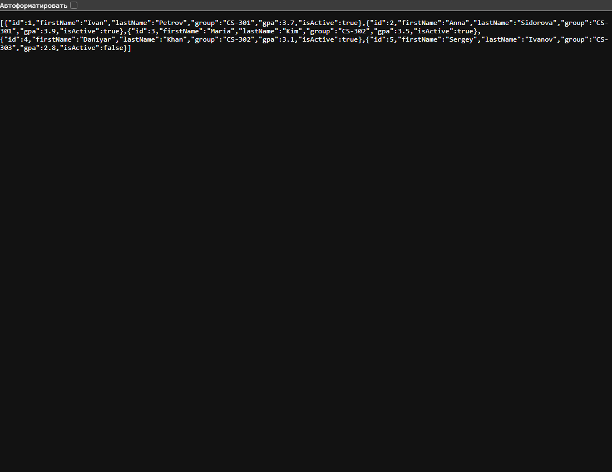

# Практическая работа 08 — версии API студентов

## Краткий отчёт

Создан API студентов с двумя версиями. Версия выбирается через URL или заголовок `X-Api-Version`.

## Выполнение по заданию

### 1. Данные

В `StudentService` хранится пять студентов. Поля модели: имя, фамилия, группа, GPA и статус.

### 2. Версии и DTO

Версия v1 возвращает `id` и `fullName`. Версия v2 возвращает подробные данные и позволяет искать студента по ID. У версий отдельные контроллеры и DTO.

### 3. Проверка запросов

| Запрос | Результат |
|---|---|
| `GET /api/v1/students` | 200, краткий список |
| `GET /api/v2/students` | 200, полный список |
| `GET /api/v2/students/1` | 200, студент |
| `GET /api/v2/students/999` | 404 |
| `GET /api/students`, заголовок `X-Api-Version: 1.0` | 200, формат v1 |
| `GET /api/students`, заголовок `X-Api-Version: 2.0` | 200, формат v2 |
| `GET /api/students`, заголовок `X-Api-Version: 3.0` | 400, неподдерживаемая версия |

## Запуск

Откройте PowerShell в этой папке:

```powershell
& "$env:LOCALAPPDATA\Programs\dotnet-sdk\dotnet.exe" run --urls http://localhost:5088
```

Проверьте адреса в браузере или через PowerShell:

```powershell
curl.exe http://localhost:5088/api/v1/students
curl.exe http://localhost:5088/api/v2/students/1
curl.exe -H "X-Api-Version: 2.0" http://localhost:5088/api/students
```

На другом компьютере с .NET SDK 10 можно использовать `dotnet run --urls http://localhost:5088`.

## Скриншот выполнения



## Вывод

URL и заголовок выбирают нужную версию. Данные общие, а формат ответа зависит от DTO версии.
